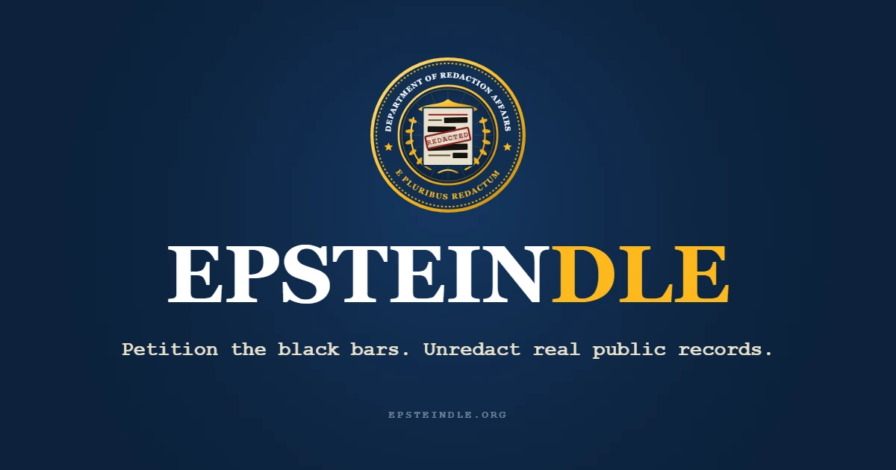

# Epsteindle

An official website of the **Department of Redaction Affairs** *(allegedly)*.

Epsteindle is a daily word game built directly over verbatim pages from the DOJ Epstein release. Every day, one new public record hits the docket with four key words blacked out. Citizens may petition the black bars directly: guess the concealed word in six attempts to declassify it in place.

**Live at [epsteindle.org](https://epsteindle.org)**

## How It Works

1. **The Daily Docket** - Everyone gets the same real excerpt from the DOJ Epstein Library (Data Sets 1-12) each day: FBI FD-302 interview reports, court filings, indictments, plea agreements, depositions, and internal memos.
2. **Petition the Black Bars** - Click any redaction bar in the document (or press `Tab`) to target it in the Petition Console. Each bar shows its exact letter count, and you can freely switch between bars at any time without losing your previous guesses or locked-in letters.
3. **Declassify in Context** - Green letters lock directly into the redaction bar inside the paragraph so you can read the surrounding sentence as the word takes shape.
4. **Six Petitions per Bar** - Crack the word within six tries to unseal it in place. Fail six times and the word remains sealed pursuant to Section 52.3(b) of the Full Disclosure Act.*
5. **Share & Inspect** - Once all bars on the record are resolved, copy your declassification receipt, review the original unredacted DOJ PDF on `justice.gov`, or pull a random backlog record from the 768-page archive.

*\*There is no Full Disclosure Act. Solid black bars marked as such were redacted by the actual government; the rest are ours. Parody site, not affiliated with any government agency.*
